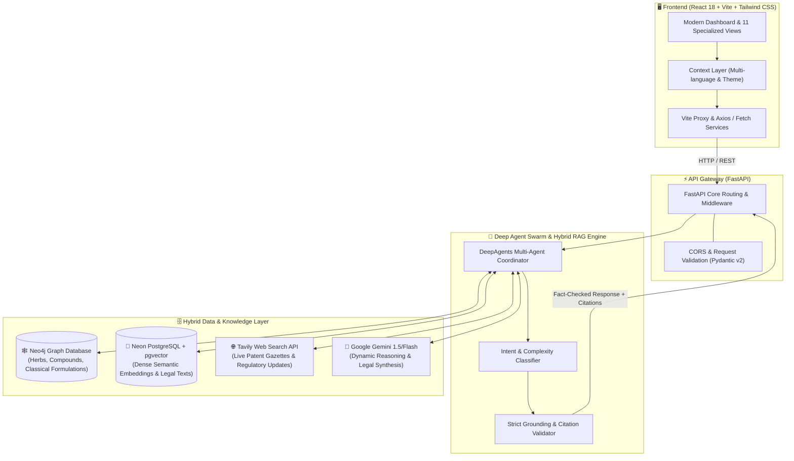

# 🌿 AYUNOVA (IP-SAKTI Sahayak)

[](https://www.sih.gov.in/)
[](https://ayush.gov.in/)
[](https://fastapi.tiangolo.com)
[](https://react.dev/)
[](https://www.typescriptlang.org/)
[](https://neo4j.com/)
[](https://neon.tech/)
[](https://opensource.org/licenses/MIT)

> **Autonomous AI Copilot & GraphRAG Platform for Ayurveda Intellectual Property, Patentability & Regulatory Compliance**  
> Developed for **Smart India Hackathon 2026** | **Problem Statement: SIH26045**  
> Organization: **Ministry of Ayush & All India Institute of Ayurveda (AIIA)**

---

## 📌 Executive Summary

Traditional Ayurvedic formulations face steep hurdles when entering domestic and global commercial markets—including strict patent restrictions under **Section 3(p)** (traditional knowledge exclusion) and **Section 3(e)** (mere admixture) of the **Indian Patents Act 1970**, complex regulatory classifications under the **Drugs & Cosmetics Act 1940**, **FSSAI** guidelines, and international export compliances (**US FDA, EMA, Health Canada, TGA**).

**AYUNOVA (IP-SAKTI Sahayak)** is an enterprise-grade AI Copilot designed to bridge classical Ayurvedic wisdom with modern patent intelligence. Powered by **Deep Multi-Agent Swarms**, **Hybrid GraphRAG (Neo4j + pgvector)**, and **real-time legal search (Tavily)**, AYUNOVA delivers instant, legally-grounded, and hallucination-free guidance for researchers, Ayush practitioners, startups, and patent attorneys.

---

## 🌟 Key Features

| Feature | Description |
| :--- | :--- |
| 🤖 **AI Copilot & Multilingual RAG** | Context-aware conversational AI grounded in classical Samhitas (*Charaka*, *Sushruta*, *Ashtanga Hridaya*), TKDL gazettes, and patent jurisprudence. |
| 🏷️ **Intelligent Product Classifier** | Instantly categorizes formulations into Classical Ayurvedic Medicine, Proprietary Ayush, FSSAI Dietary Supplement, or Herbal Cosmetic with Schedule T guidelines. |
| ⚖️ **Section 3(p) & 3(e) Patentability Advisor** | Analyzes whether a polyherbal formulation qualifies as a non-patentable traditional admixture or possesses patentable synergistic efficacy (Form 1, Form 2, NBA approvals). |
| 🕸️ **Neo4j Knowledge Graph & GraphRAG** | Traverses deep relationships between Ayurvedic herbs, bioactive phytocompounds, classical formulations, pharmacological actions (*Rasapanchaka*), and granted patents. |
| 🔬 **Research Intelligence Engine** | Gathers and summarizes clinical trials, PubMed studies, Ayush research databases, and pharmacokinetic evidence to substantiate synergistic claims. |
| 📑 **Formulation Document Analyzer** | Parses uploaded PDFs/DOCX formulation sheets to perform instant automated prior-art conflict detection and TKDL matching. |
| 🌐 **India vs. Global Regulatory Navigator** | Side-by-side regulatory pathways comparing CDSCO/Ayush norms with international agencies (US FDA Dietary Supplement vs IND, EU EMA THMPD, TGA Australia). |
| 📋 **Ayush Compliance & Licensing Checklist** | Guided workflows for Ayush manufacturing licenses (Form 24D/25D), GMP certification, clinical trial ethics clearance, and National Biodiversity Authority (NBA) permissions. |
| 🛡️ **Admin Audit Logs & Telemetry** | Full auditable trail of all generated legal citations, search queries, document evaluations, and system health status. |

---

## 🏗️ System Architecture



---

## 📂 Project Structure

```
ip-sakti-sahayak-main/
├── 📁 frontend/                         # ⚛️ Frontend Application
│   ├── 📁 src/
│   │   ├── 📁 components/               # Reusable UI (Sidebar, Topbar, Citations, Modals)
│   │   ├── 📁 pages/                    # 11 Dedicated System Modules:
│   │   │   ├── AIAssistantPage.tsx      # Interactive RAG Legal Assistant
│   │   │   ├── ProductClassificationPage.tsx # Regulatory Classifier
│   │   │   ├── IPProtectionAdvisorPage.tsx   # Patentability & Sec 3(p)/3(e) Engine
│   │   │   ├── TraditionalKnowledgePage.tsx  # TKDL & Classical Herb Explorer
│   │   │   ├── ResearchIntelligencePage.tsx  # PubMed & Ayush Paper Search
│   │   │   ├── IndiaVsInternationalPage.tsx  # Global Market Export Comparison
│   │   │   ├── DocumentAnalyzerPage.tsx      # Formulation File Inspector
│   │   │   ├── ComplianceChecklistPage.tsx   # Licensing & GMP Roadmap
│   │   │   ├── DashboardPage.tsx             # System Overview & Metrics
│   │   │   ├── HistoryPage.tsx               # Session History & Saved Queries
│   │   │   └── AdminPage.tsx                 # System Health & Audit Telemetry
│   │   ├── 📁 services/                 # API client layers & data fetching
│   │   ├── 📁 context/                  # State management & localization
│   │   └── 📁 types/                    # Strict TypeScript definitions
│   ├── 📄 vite.config.ts                # Vite config with backend proxy (:8000)
│   ├── 📄 tailwind.config.js            # Tailwind CSS styling tokens
│   └── 📄 package.json                  # Frontend dependencies
│
├── 📁 backend/                          # 🐍 Python FastAPI Core
│   ├── 📁 app/
│   │   ├── 📁 api/                      # Modular API endpoints
│   │   │   ├── chat.py                  # AI Copilot & Hybrid RAG endpoint
│   │   │   ├── classification.py        # Regulatory classification
│   │   │   ├── ip_advisor.py            # Patentability and prior-art search
│   │   │   ├── graph.py                 # Neo4j Graph queries & visualization
│   │   │   ├── research.py              # Research paper intelligence
│   │   │   ├── sources.py               # Classical texts & legal statutes
│   │   │   └── admin.py                 # System health and audit logs
│   │   ├── 📁 core/                     # App settings, DB connections, Neo4j driver
│   │   ├── 📁 data/                     # Ingested datasets (TKDL, Patent Acts, Classifications)
│   │   ├── 📁 models/                   # Pydantic data schemas
│   │   ├── 📁 services/                 # Multi-Agent processing, LLM connectors & RAG logic
│   │   └── 📄 main.py                   # FastAPI initialization
│   ├── 📁 tests/                        # 🧪 34+ Automated Pytest Test Suites
│   ├── 📄 run.py                        # UTF-8 compliant Uvicorn server launcher
│   ├── 📄 requirements.txt              # Backend dependencies
│   └── 📄 .env                          # Environment credentials & endpoints
│
├── 📄 package.json                      # 🚀 Root orchestration commands
├── 🚀 start_all.bat                     # 1-Click launcher for both Frontend & Backend
├── 🚀 start_backend.bat                 # 1-Click launcher for Backend
└── 🚀 start_frontend.bat                # 1-Click launcher for Frontend
```

---

## 🛠️ Tech Stack

### Frontend
- **Framework:** React 18 with TypeScript
- **Bundler & Dev Server:** Vite 5
- **Styling:** Tailwind CSS 3, Lucide React icons
- **Routing:** React Router v6
- **Architecture:** Component-driven, responsive, accessible dark/light themes

### Backend
- **Framework:** Python 3.10+ / FastAPI
- **Server:** Uvicorn with async event loops
- **Validation:** Pydantic v2
- **Document Processing:** PyPDF, python-docx, pandas
- **Testing:** Pytest, HTTPX

### AI & Data Intelligence
- **Multi-Agent Framework:** DeepAgents & LangGraph
- **Knowledge Graph:** Neo4j (Cypher queries for plant-compound-disease-patent ontology)
- **Vector Database:** Neon Serverless PostgreSQL with `pgvector`
- **Dynamic Reasoning:** Google Gemini API (`google-genai`, `langchain-google-genai`)
- **Live Search & Fact-Checking:** Tavily Search API

---

## ⚡ Quick Start & Installation

### Option A: 1-Click Run (Windows)
Simply double-click the included batch script:
```cmd
start_all.bat
```
*This starts both the FastAPI backend (`http://localhost:8000`) and the Vite React frontend (`http://localhost:5173`) in separate terminal windows.*

---

### Option B: Manual Setup

#### 1. Clone the Repository
```bash
git clone https://github.com/rohanshinde8080/ayunova-ip-sahayak.git
cd ayunova-ip-sahayak
```

#### 2. Backend Setup
```bash
# Navigate to backend directory
cd backend

# Create and activate virtual environment
python -m venv venv

# Windows:
.\venv\Scripts\activate
# Linux/macOS:
source venv/bin/activate

# Install dependencies
pip install -r requirements.txt

# Start backend server
python run.py
```
> Backend runs at: **`http://localhost:8000`**  
> Swagger Documentation: **`http://localhost:8000/docs`**

#### 3. Frontend Setup
In a new terminal:
```bash
# Navigate to frontend directory
cd frontend

# Install npm dependencies
npm install

# Start Vite development server
npm run dev
```
> Frontend Web App runs at: **`http://localhost:5173`**

---

## 🔐 Environment Configuration

Create or update `backend/.env` with your credentials:

```env
# Server Settings
HOST=127.0.0.1
PORT=8000
ENVIRONMENT=development
CORS_ORIGINS=http://localhost:5173,http://127.0.0.1:5173

# Google Gemini API Key (For reasoning & dynamic synthesis)
GEMINI_API_KEY=your_gemini_api_key_here

# Tavily Search API (For real-time patent & legal searches)
TAVILY_API_KEY=your_tavily_api_key_here
DEEP_AGENTS_ENABLED=true

# Neon PostgreSQL with pgvector
DATABASE_URL=postgresql://<user>:<password>@<neon-host>/neondb?sslmode=require

# Neo4j Graph Database
NEO4J_URI=neo4j://127.0.0.1:7687
NEO4J_USER=neo4j
NEO4J_PASSWORD=your_neo4j_password
NEO4J_DATABASE=neo4j
```

---

## 📡 API Reference & Key Endpoints

| Method | Endpoint | Description |
| :---: | :--- | :--- |
| `GET` | `/` | System root & hackathon metadata |
| `GET` | `/api/health` | Comprehensive health check (PostgreSQL, Neo4j, RAG engine) |
| `POST` | `/api/chat/query` | Conversational RAG Copilot with legal citations |
| `POST` | `/api/classification/evaluate` | Classify formulation (Classical / Proprietary / FSSAI / Cosmetic) |
| `POST` | `/api/ip-advisor/analyze` | Section 3(p) & 3(e) patentability & prior-art assessment |
| `GET` | `/api/graph/subgraph` | Fetch connected botanical & formulation subgraph from Neo4j |
| `POST` | `/api/research/search` | Search indexed clinical research and scientific publications |
| `GET` | `/api/sources/list` | List verified statutory references (TKDL, Patents Act, BDA 2002) |
| `GET` | `/api/admin/logs` | Fetch system audit logs and telemetry metrics |

---

## 🧪 Testing & Verification

AYUNOVA includes a comprehensive automated test suite covering unit, integration, and E2E evaluation across all system phases:

```bash
cd backend
pytest -v
```

**Key Test Coverage:**
- 🛡️ Strict RAG Grounding & Anti-Hallucination checks
- ⚖️ Section 3(p) & 3(e) novelty & prior art detection
- 🕸️ Neo4j Knowledge Graph connectivity & Cypher query execution
- 🔍 Tavily real-time patent search integration
- 🤖 Deep Agent multi-agent swarm orchestration & memory rubrics

---

## 🏆 Smart India Hackathon 2026 Details

- **Problem Statement ID:** SIH26045
- **Problem Statement Title:** Development of AI based decision-support system/Copilot for Intellectual Property (IP) Protection and Regulatory Guidance in Ayurveda (IP-SAKTI Sahayak)
- **Ministry / Department:** Ministry of Ayush & All India Institute of Ayurveda (AIIA)
- **Theme:** Smart Automation / Healthcare / MedTech & Traditional Knowledge

---

## 📄 License & Attribution

This project is licensed under the **MIT License** - see the [LICENSE](LICENSE) file for details.

*Special thanks to the Ministry of Ayush, AIIA, CSIR-TKDL, and the Smart India Hackathon 2026 organizing committee.*
